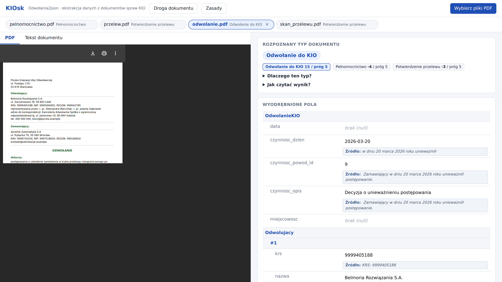
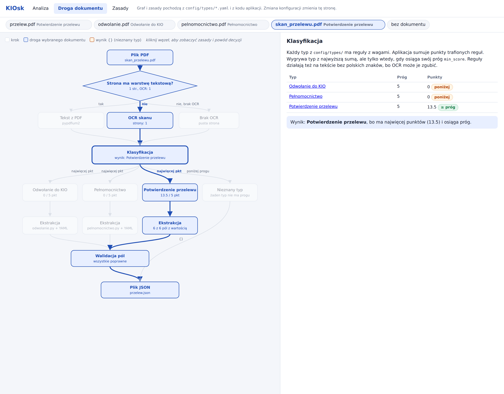

# KIOsk

KIOsk reads the PDF documents of a KIO appeal case and writes one JSON file for each document.

## How it works

- **Rules, not an LLM.** Each document type has weighted rules in `config/types/*.yaml`. The type with the most points wins if it reaches its threshold. A document of an unknown type gives `{}`.
- **OCR for scans.** A page without a text layer goes to RapidOCR. The models are in the `pip` package, so the run needs no internet.
- **New type without code.** To add a document type, add a YAML file.
- **Explained decisions.** The web interface shows the source text of each value and the path of each document.

## Results

All measurements ran on a CPU without a GPU.

| Test set | Files | F1 |
|---|---|---|
| All test PDF files | 226 | 0.999 |
| Documents with a text layer, dev / holdout | 135 / 45 | 1.000 / 1.000 |
| Real scans (OCR) | 30 | 0.992 |
| Documents of an unknown type (expected `{}`) | 12 | 1.000 |

A PDF with a text layer takes approximately 0.01 s. A scan takes approximately 11 s.

## Quick start

To process a case with Docker, do these steps:

1. Put the PDF files into `input/<case>/`.
2. Run `docker compose run --rm cli`.
3. Read the JSON files in `output/<case>/`.

To start the web interface on http://127.0.0.1:8000, run `docker compose up`.

## License

[MIT](LICENSE)
